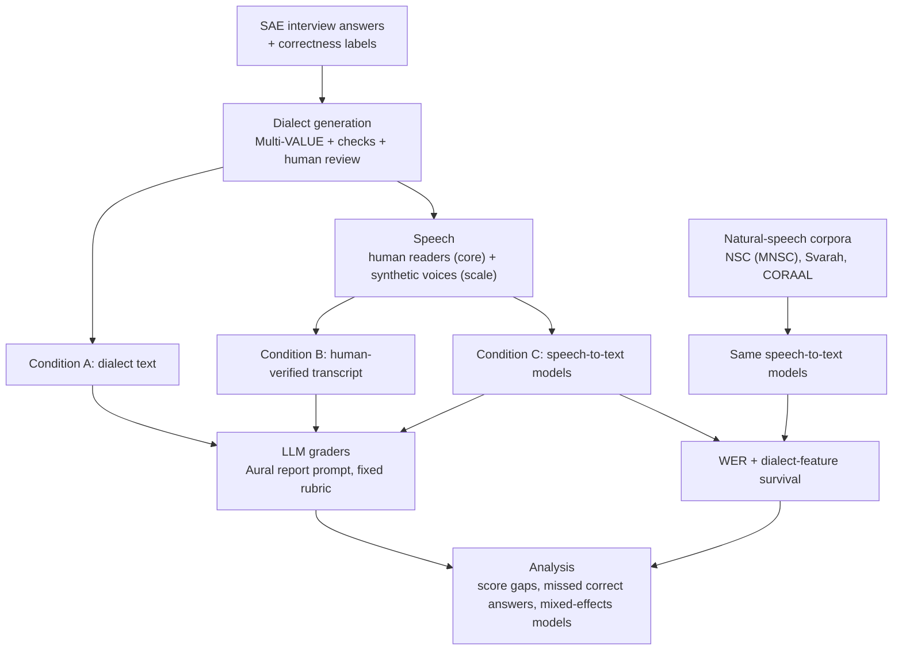

# Study plan (tentative)

> **Status: draft, 2026-11-09.** Nothing here is final. Items marked **TBD** need a team decision. Model and dataset choices are candidates to check before use, because leaderboards and licences change.

## 1. Research question

When answer correctness is held fixed, does an AI interview pipeline score answers lower when they are written or spoken in a non-standard English dialect? And how much of any gap comes from the speech-to-text step and how much from the LLM grader?

**Dialects (TBD):** Indian English, Colloquial Singapore English (Singlish), possibly AAE. Standard American English (SAE) is the baseline.

### Hypotheses

- **H1.** For equally correct answers, LLM graders give lower scores to dialect variants than to SAE answers.
- **H2.** Speech-to-text makes more errors on dialect speech, and the errors fall disproportionately on dialect features.
- **H3.** Speech-to-text sometimes *standardizes* dialect grammar ("he go" becomes "he goes"). That changes how much grader bias appears in the audio pipeline compared with the text-only condition.
- **H4.** Correct dialect answers are failed more often than correct SAE answers, even where average scores look similar.

## 2. Design

The same answer content appears in every dialect. Ideally the same speaker reads both the SAE and the dialect version, following matched-guise logic. Correctness labels are the ground truth.

### Grading conditions

| Condition | Grader input | Isolates |
|---|---|---|
| **A. Text** | `final_text`, the reviewed dialect variant | Grader bias with no speech involved |
| **B. Verified transcript** | What the speaker actually said, checked by a human | Speakers standardizing while reading (A vs B) |
| **C. Speech-to-text** | Each speech-to-text model's transcript | Speech-to-text effect, including standardizing (B vs C) |

### Factors

| Factor | Levels |
|---|---|
| Dialect | SAE, Indian English, Singlish (+ AAE, TBD) |
| Correctness | From the `correctness` column, e.g. correct / partial / incorrect (TBD) |
| Speaker group | Native speakers of each variety. Crossed with text dialect as {SAE text, dialect text} × {speaker group}, so accent and grammar can be separated |
| Voice source | Human recording (core); synthetic voice cloned from consenting participants (scale-up, TBD) |
| Speech-to-text model | 3–4 models (see §4) |
| Grader model | 2–3 LLMs (see §4) |

## 3. Architecture (tentative)

### Stages

1. **Answer bank (TBD).** SAE answers to technical interview questions, with correctness labels. Who writes them, how many there are, and the rubric are still to decide.
2. **Dialect generation** (`generate_dialects.py`, exists). Multi-VALUE rewrites each answer; the script protects code and Big-O spans, runs heuristic checks and flags rows for review. Speakers of each variety then rate naturalness and meaning preservation.
3. **Speech.**
   - Human recordings, if IRB or the course allows. Each recording gets a human check of the dialect spans, so we know what was actually said.
   - Synthetic voices as a scale-up, cloned only from consenting participants.
   - Protected terms are written the way people say them ("O of n log n").
4. **Speech-to-text.** Several open models run offline on the GPU cluster (H100/H200). We do **not** use Aural's live browser voice relay.
5. **Grading.** We use Aural's report and evaluation prompt as the grader template. It is pointed through `OPENAI_BASE_URL` at open models served by vLLM on the cluster, plus one hosted API model to represent deployed systems. The prompt, rubric and model versions are frozen before any data runs.
6. **Analysis.** Scores, error rates, feature survival and statistics (§5).

## 4. Candidate tools and data

All of these are tentative. Check each against its current model card or leaderboard before choosing.

### Speech-to-text candidates

Rankings come from blog summaries of the Hugging Face Open ASR Leaderboard, Oct 2026:

- **Whisper large-v3.** For comparability with prior bias studies.
- **NVIDIA Nemotron 3.5 Transcribe.**
- **Qwen3-ASR-1.7B.**
- **Cohere Transcribe.**

### Grader candidates

- **Open, on vLLM:** gpt-oss-120b, which fits on one 80 GB GPU, and a Qwen3.5 model.
- **Hosted:** one API model, e.g. `gpt-4o`, which aural-oss uses for reports when an OpenAI key is set.

### Interview platform candidate

**Aural**, [`1146345502/aural-oss`](https://github.com/1146345502/aural-oss), MIT licence. Its follow-up questions adapt to each answer, so set follow-up depth to the minimum and keep the questions fixed. Otherwise different dialects get different follow-ups.

### TTS / voice-cloning candidates (scale-up only)

OpenVoice (MIT, accent control), XTTS-v2, MeloTTS (has an Indian English accent) and svara-TTS. Accent quality has to be validated by speakers of each variety.

### Natural-speech corpora (speech-to-text baselines only; no correctness labels)

| Corpus | Variety | Access | Licence |
|---|---|---|---|
| NSC via [`AudioLLMs/Multitask-National-Speech-Corpus-v1-extend`](https://huggingface.co/datasets/AudioLLMs/Multitask-National-Speech-Corpus-v1-extend), ASR test splits for Parts 1, 3, 5 and 6, about 4 GB | Singapore English, read and conversational, with speaker metadata | Hugging Face, ungated; official copy via the IMDA form | Singapore Open Data Licence v1.0, attribution required |
| [Svarah](https://huggingface.co/datasets/ai4bharat/Svarah) | Indian-accented English, 9.6 h, 117 speakers | Hugging Face, accept terms | CC BY 4.0 |
| [CORAAL](https://lingtools.uoregon.edu/coraal/) | AAE sociolinguistic interviews | Free download | CC BY-NC-SA 4.0 |

## 5. Measurements and analysis

### Grader outcomes

- Score gap between each dialect and SAE, within each correctness level.
- **Missed correct answers:** how often correct answers are failed, per dialect.

### Speech-to-text outcomes

- WER per model, dialect and speaker group.
- **Feature survival.** Align the SAE source with `final_text` to find the dialect edits. Then align each transcript with `final_text`, and label every edit as kept, standardized, other error or deleted. Compare this with the error rate on ordinary words in the same clip.
- Never apply Whisper's text normalizer before measuring survival. It rewrites gotta, gonna, wanna, y'all and every n't.

### Statistics

- Mixed-effects model: `score ~ dialect * correctness + surviving_features + (1 + dialect | item) + (1 + dialect | speaker)`.
- Paired permutation tests on item-level differences.
- Repeated grader runs, to measure run-to-run variance.
- A power simulation **before** recording.

### Validity checks

- Naturalness and meaning ratings from speakers of each variety, with inter-rater agreement reported.
- Optional automatic meaning check: NLI entailment in both directions, or BERTScore.

## 6. Ethics and data use

- **IRB.** Voice recordings are identifiable data. Ask the instructor whether recording classmates needs IRB for a course project. Consent must cover storage, reuse, and sending audio to any outside API.
- **Multi-VALUE data use agreement.** It forbids mockery and impersonation. Prefer native speakers of each variety, and don't ask people to perform dialects that aren't theirs.
- **Corpora.**
  - Never clone the voices of NSC, Svarah or CORAAL speakers.
  - Report results only in aggregate, and don't publish clips.
  - Include the attribution notices the licences require.
- **AI-use disclosure.** Follow the CS 6120 policy.

## 7. Work plan

### Phase 1: fix the generator

- [ ] Turn off Multi-VALUE's `surface_contract` for Indian English and Singlish. It adds *gotta*, *I'ma* and *tryna* to every dialect and doesn't log them.
- [ ] Count a row as "changed" only when a real rule fired.
- [ ] Add a check on degree words (very, more, most, much, too…), or turn off `too_sub`, `more_much` and `zero_degree`.
- [ ] Turn off `yall` for Indian English and Singlish.
- [ ] Catch Multi-VALUE's spaCy/Stanza mismatch errors so one bad answer can't stop the run (upstream issue #7).
- [ ] Extend the negation word list. Widen Big-O masking to cover nested parentheses and Θ/Ω. Reject empty answers. Warn on unknown `--exclude-features` names.
- [ ] Do a test run of about 20 answers on the cluster.

### Phase 2: dialect measurement

- [ ] Record dialect density (rules ÷ tokens) for each row, and either aim for a target density or control for it.
- [ ] Report the feature distribution per dialect after filtering.
- [ ] Get naturalness and meaning ratings from speakers of each variety.

### Phase 3: repo and reproducibility

- [ ] Commit a small sample CSV and the tests. `data/` and `tests/` are currently gitignored.
- [ ] Remove the line in `.gitignore` that ignores `.gitignore` itself.
- [ ] Change the README's Python requirement to 3.11 or 3.12. The pinned numpy and spaCy have no wheels for 3.13.
- [ ] Pin `en_core_web_sm`, and write package versions into the output.

### Phase 4: study pipeline

- [ ] Decide the answer bank, rubric and correctness levels.
- [ ] Decide the speech-to-text and grader models, then freeze the prompt and versions.
- [ ] Build condition A (text to grader) first, since it needs no speakers.
- [ ] Set up the speech-to-text runs and feature-survival scoring on the cluster.
- [ ] Download the NSC test splits to the cluster, submit the IMDA form, and get Svarah and CORAAL.
- [ ] Run the power simulation, then IRB if needed, then recording.
- [ ] Run conditions B and C, then the analysis.

### Phase 5: paper

- [ ] Write the limitations: synthetic dialect is not real dialect; Singlish has never been validated in Multi-VALUE; read speech is easier for speech-to-text than conversation; the meaning checks are heuristic.
- [ ] Write related work (§9).

## 8. Open decisions

| Decision | Options | Owner |
|---|---|---|
| Grader platform | Aural prompt vs. our own rubric prompt | TBD |
| Dialects | Indian English, Singlish, AAE? | TBD |
| Human recordings | Yes, if IRB or the course allows / synthetic only | TBD |
| Speech-to-text models | From the §4 candidates | TBD |
| Grader models | From the §4 candidates | TBD |
| Answer bank source | Written by the team / existing interview Q&A set | TBD |
| Timeline | Confirm the course final deadline | TBD |

## 9. Key references

- Ziems et al. 2023, *Multi-VALUE*, ACL. https://aclanthology.org/2023.acl-long.44
- Hofmann et al. 2024, *AI generates covertly racist decisions about people based on their dialect*, Nature 633:147.
- "Invisible Filters", AIES 2025. https://arxiv.org/abs/2508.16673
- Koenecke et al. 2020, *Racial disparities in automated speech recognition*, PNAS 117:7684.
- Martin & Tang 2020, habitual *be* and ASR errors, Interspeech.
- Lin et al. 2025, *ReDial*, ACL. https://aclanthology.org/2025.acl-long.317/
- Bokkahalli Satish et al. 2026, voice cloning for accent bias in SpeechLLMs, Interspeech. https://arxiv.org/abs/2603.16941
- Wang et al. 2025, *Advancing Singlish Understanding* (MNSC). https://arxiv.org/abs/2501.01034
- Javed et al. 2023, *Svarah*, Interspeech. https://arxiv.org/abs/2305.15760
- Barr et al. 2013, random-effects structure, JML 68:255.
- Card et al. 2020, *With Little Power Comes Great Responsibility*, EMNLP.
