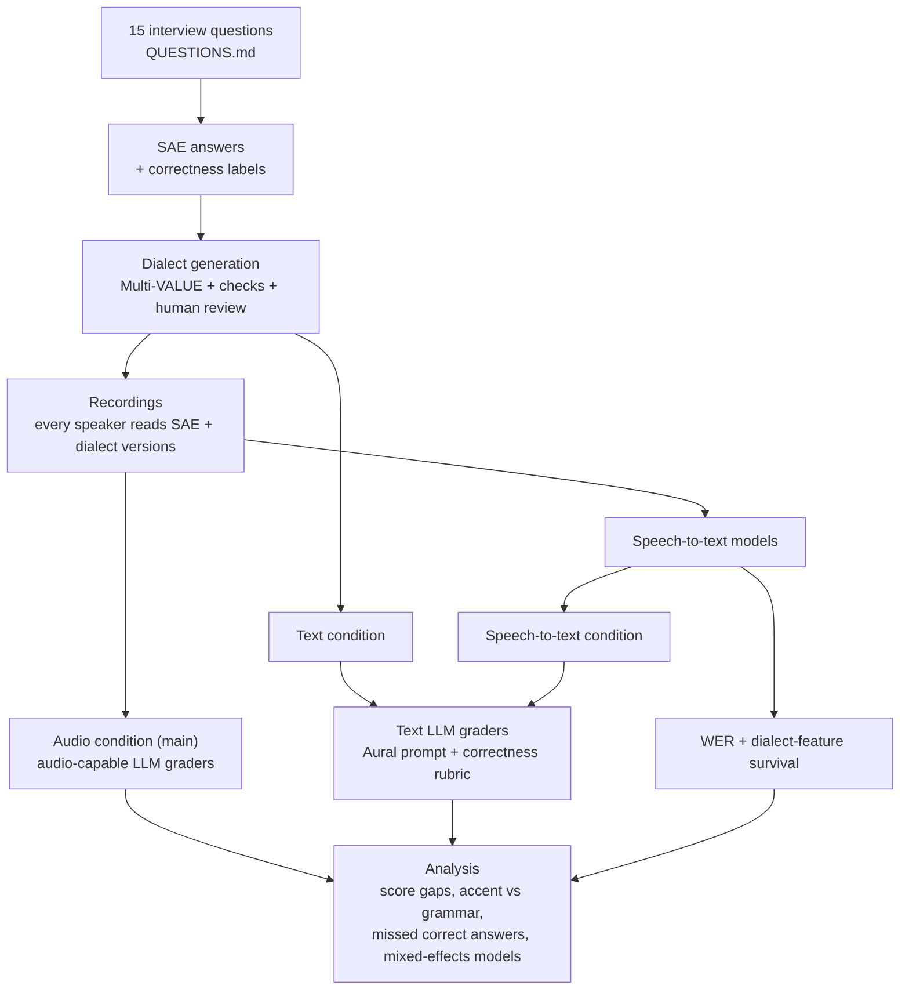

# Study plan (tentative)

> **Status: draft, updated 2026-11-20.** Nothing here is final. Items marked **TBD** need a team decision. Model and dataset choices are candidates to check before use, because leaderboards and licences change.
>
> **Change since the first draft:** raw audio graded by an audio-capable LLM is now the **main condition**, because the study is about how people talk. Text-only and speech-to-text grading stay as cheap comparisons on the same material.

## 1. Research question

When answer correctness is held fixed, does an AI interview pipeline score people differently depending on the English dialect they speak? And how much of any gap comes from **how they sound** (accent, delivery), from **dialect grammar**, and from the **speech-to-text step** used by text-based tools?

**Dialects (TBD):** Indian English, Colloquial Singapore English (Singlish), possibly AAE. Standard American English (SAE) is the baseline.

### Hypotheses

- **H1 (audio, main).** Audio-capable LLM graders give lower content scores to dialect speakers than to SAE speakers for equally correct answers.
- **H2 (accent vs grammar).** Within the audio condition, part of the gap comes from accent (same SAE text, different speakers) and part from dialect grammar (same speaker, SAE text vs dialect text).
- **H3 (voice scores).** Delivery scores (confidence, clarity, tone) are lower for dialect speakers, partly for reasons unrelated to answer quality (see §5).
- **H4 (speech-to-text).** Speech-to-text makes more errors on dialect speech and sometimes standardizes dialect grammar ("he go" becomes "he goes"). That makes the transcript-based pipeline behave differently from the audio pipeline. Whether dialect survives transcription is an open question, not an assumption.
- **H5 (error rates).** Correct dialect answers are failed more often than correct SAE answers, even where average scores look similar.

## 2. Design

The same answer content appears in every dialect. Correctness labels are the ground truth.

### Grading conditions

| Condition | Grader input | Role | Status |
|---|---|---|---|
| **Audio (main)** | The recording itself, sent to an audio-capable LLM | Main result: does how people talk change the score? | Needs recordings and audio-capable models |
| **Text** | `final_text`, the reviewed dialect variant | Grammar effect with no voice involved | Can run now |
| **Speech-to-text** | Each speech-to-text model's transcript, sent to a text LLM | The common real-world path (most tools grade a transcript), and a check on whether dialect survives transcription | Same recordings, extra compute only |
| **Verified transcript** (optional) | What the speaker actually said, checked against the script | Separates speech-to-text errors from speakers changing the script | Only if time allows |

Comparisons:
- **Audio vs text:** what the voice adds beyond the words.
- **Speech-to-text vs text:** how much transcription changes the score.
- **Verified transcript vs speech-to-text:** pure speech-to-text error, if we do the verified condition.

### Speaker design (separating accent from grammar)

Every speaker reads **both** the SAE version and the dialect version of different items. Items are counterbalanced (Latin square) so that no speaker reads both versions of the same answer.

| | SAE text | Dialect text |
|---|---|---|
| **SAE speakers** | Baseline | Not used (would be a performance, see §6) |
| **Dialect speakers** | Accent effect (vs baseline) | Accent + grammar effect |

- **Accent effect:** dialect speakers on SAE text vs SAE speakers on SAE text.
- **Grammar effect:** dialect speakers on dialect text vs the same speakers on SAE text.

### Recording protocol

Audio graders and Aural's voice scores react to loudness and noise. Without these controls, the setup would show up as a fake "dialect" effect.

- The same microphone (or the same phone model) and a quiet room for every speaker.
- One fixed format, e.g. 16 kHz mono WAV, with loudness normalized after recording.
- A short practice read before each session. Mistakes get re-recorded, not edited.
- Log the speaker ID, dialect, session and any deviations from the script.

**Sample size.** Four Indian English speakers are available from the week of 2026-11-23. That makes a **pilot**, because differences between individual speakers will dominate with so few people. We also need SAE speakers recorded the same way (number TBD). Results get reported as a pilot, possibly supplemented by synthetic voices cloned from consenting participants.

### Factors

| Factor | Levels |
|---|---|
| Dialect (speaker) | SAE, Indian English, Singlish (+ AAE, TBD) |
| Text version | SAE text, dialect text |
| Correctness | correct / partial / incorrect |
| Voice source | Human recording (core); synthetic voice from consenting participants (scale-up, TBD) |
| Grader | 2–3 models per condition (see §4) |
| Speech-to-text model | 2–4 models, speech-to-text condition only |

## 3. Architecture (tentative)

### Stages

1. **Questions** (done): 15 questions in `QUESTIONS.md`, covering 5 topics at 3 difficulty levels each.
2. **Answer bank** (draft under review): 90 SAE answers, one per question × correctness level (correct / partial / incorrect) × 2 wordings, each with a short reason for its label. Every label needs a human check. Answer lengths are kept close across levels so length can't give away correctness.
3. **Dialect generation** (`generate_dialects.py`): Multi-VALUE rewrites, heuristic checks and human review. Consistency fixes are in progress (§7, Phase 1).
4. **Recordings:** human speakers following the speaker design and recording protocol above.
5. **Grading.**
   - **Audio:** the recording plus the question go straight to audio-capable LLMs, a mix of hosted and open models (see §4). The prompt asks for an interviewer-style grade of content and delivery. It never asks the model to rate the accent; the accent effect is measured by comparing speaker groups, not by asking for it.
   - **Text and speech-to-text:** the text goes to text LLMs with two prompts: Aural's per-answer prompt and a technical-correctness rubric. Drafts are in progress.
   - Prompts, rubric, model versions and sampling settings are frozen before any data runs.
6. **Analysis:** §5.

## 4. Candidate tools and data

All of these are tentative. Check each against its current model card or documentation before choosing.

- **Audio-capable graders** (take raw audio and answer questions about it; checked 2026-11-20). Proposed set: 2 hosted + 2 open + MERaLiON.

| Model | Type | Why consider it |
|---|---|---|
| Gemini (current Flash or Pro) | Hosted | Documented audio understanding, including emotion detection; widely deployed. Aural also uses it for audio grading |
| OpenAI `gpt-audio-1.5` / `gpt-audio-mini` | Hosted | Audio input through Chat Completions; a second major commercial vendor |
| Qwen3-Omni | Open, on the cluster | Audio in; served with vLLM-Omni |
| Voxtral Small (24B, Apache 2.0) | Open, on the cluster | Speech understanding and audio reasoning |
| MERaLiON-2 / MERaLiON-3 (A*STAR) | Open, on the cluster | Built for Singapore English. A useful contrast: does a regionally trained model show less Singlish bias? (MERaLiON Public License) |
| Also possible | Open | MiMo-Audio-7B, Audio Flamingo Next, Kimi-Audio, Step-Audio 2 mini |

  Claude is **not** usable for the audio condition: its API has no native audio input, so it could only grade a transcript.
- **Text graders:** open models on vLLM, e.g. gpt-oss-120b (fits on one 80 GB GPU) or a Qwen3.5 model, plus one hosted model.
- **Speech-to-text candidates** (from blog summaries of the Open ASR Leaderboard, Oct 2026):
  - Whisper large-v3, for comparability with prior bias studies.
  - NVIDIA Nemotron 3.5 Transcribe.
  - Qwen3-ASR-1.7B.
  - Cohere Transcribe.
- **Interview platform:** Aural, [`1146345502/aural-oss`](https://github.com/1146345502/aural-oss), MIT licence, pinned at commit `6f85fee`. We reuse its prompts and scoring logic offline; we don't run its live voice relay.
- **Forced alignment** (verified-transcript condition only): Montreal Forced Aligner lines up each recording with its script, so a person only has to check the spans that don't match.
- **TTS / voice cloning** (scale-up only): OpenVoice, XTTS-v2, MeloTTS, svara-TTS. Accent quality has to be validated by speakers of each variety.
- **Natural-speech corpora** (speech-to-text baselines only; they have no correctness labels):

| Corpus | Variety | Access | Licence |
|---|---|---|---|
| NSC via [`AudioLLMs/Multitask-National-Speech-Corpus-v1-extend`](https://huggingface.co/datasets/AudioLLMs/Multitask-National-Speech-Corpus-v1-extend), ASR test splits for Parts 1, 3, 5 and 6, about 4 GB | Singapore English, read and conversational, with speaker metadata | Hugging Face, ungated; official copy via the IMDA form | Singapore Open Data Licence v1.0, attribution required |
| [Svarah](https://huggingface.co/datasets/ai4bharat/Svarah) | Indian-accented English, 9.6 h, 117 speakers | Hugging Face, accept terms | CC BY 4.0 |
| [CORAAL](https://lingtools.uoregon.edu/coraal/) | AAE sociolinguistic interviews | Free download | CC BY-NC-SA 4.0 |

## 5. Measurements and analysis

### Content scores (all conditions)

- Score gap between dialect and SAE, within each correctness level.
- **Missed correct answers:** how often correct answers are failed, per dialect.
- In the audio condition, the accent and grammar effects from the speaker design.

### Voice scores (audio condition)

- The audio LLM's delivery scores (confidence, clarity, tone).
- Aural's own voice scores, if we reproduce them. At commit `6f85fee` these come from fixed formulas, not the LLM, and three of their properties matter for this study:
  1. **"Clarity" is speaking pace:** words per minute, counted from the *transcript*. Speech-to-text errors therefore change it. Count words from the script or the verified transcript instead.
  2. **"Confidence" and "tone" come from loudness and loudness variation.** They measure the microphone and room as much as the speaker, which is why the recording protocol matters.
  3. **"like" is counted as a filler word.** Multi-VALUE's Indian English applies two features that insert "like" (`quotative_like`, `acomp_focusing_like`) with probability 1.0, so the dialect text alone raises the filler count. Singlish particles ("lah", "ah") are not on the list. Report filler counts with and without "like".

### Speech-to-text (speech-to-text condition)

- WER per model, dialect and speaker.
- **Feature survival:**
  1. Align the SAE source with `final_text` to find the dialect edits.
  2. Align each transcript with `final_text`.
  3. Label every edit as kept, standardized, other error, or deleted.
  4. Compare this with the error rate on ordinary words in the same recording.
- Never apply Whisper's text normalizer before measuring survival. It rewrites gotta, gonna, wanna, y'all and every n't.

### Statistics

- Mixed-effects model: `score ~ speaker_dialect * text_version * correctness + (1 | item) + (1 | speaker)`, adding random slopes where the data supports them. Answer length goes in as a covariate.
- Paired comparisons on matched items.
- Repeated grader runs, to measure run-to-run variance.
- With only 4 speakers per group, the statistics describe a pilot, so the paper reports effect sizes and confidence intervals rather than only p-values.

### Validity checks

- Naturalness and meaning ratings from speakers of each variety, with inter-rater agreement reported.
- Optional automatic meaning check: NLI entailment in both directions, or BERTScore.

## 6. Ethics and data use

- **IRB.** Voice recordings are identifiable data. Ask the instructor whether recording classmates needs IRB for a course project. Consent must cover storage, reuse, and sending audio to outside APIs. The audio condition sends recordings to Gemini if we use it, so say so explicitly in the consent form.
- **Multi-VALUE data use agreement.** It forbids mockery and impersonation. Only native speakers read dialect text; SAE speakers read only SAE text.
- **Corpora.**
  - Never clone the voices of NSC, Svarah or CORAAL speakers.
  - Report results only in aggregate, and don't publish clips.
  - Include the attribution notices the licences require.
- **AI-use disclosure.** Follow the CS 6120 policy. This includes the AI-drafted answer bank.

## 7. Work plan

### Phase 1: fix the generator

- [ ] Turn off Multi-VALUE's `surface_contract` for Indian English and Singlish. It adds *gotta*, *I'ma* and *tryna* to every dialect and doesn't log them.
- [ ] Count a row as "changed" only when a real rule fired.
- [ ] Add a check on degree words (very, more, most, much, too…), or turn off `too_sub`, `more_much` and `zero_degree`.
- [ ] Turn off `yall` for Indian English and Singlish.
- [ ] Catch Multi-VALUE's spaCy/Stanza mismatch errors so one bad answer can't stop the run (upstream issue #7).
- [ ] Extend the negation word list. Widen Big-O masking to cover nested parentheses and Θ/Ω. Reject empty answers. Warn on unknown `--exclude-features` names.
- [ ] Record dialect density (rules ÷ tokens) for each row.

### Phase 2: text condition (now)

- [ ] Review the correctness labels on the 90 draft SAE answers.
- [ ] Generate dialect versions, then have speakers of each variety review them.
- [ ] Freeze the text grader prompts and models, then run grading.

### Phase 3: recordings (from the week of 2026-11-23)

- [ ] Confirm whether IRB is needed, and prepare the consent form.
- [ ] Recruit SAE speakers to record alongside the 4 Indian English speakers.
- [ ] Fix the recording setup (microphone, room, format) and build the counterbalanced reading lists.
- [ ] Record, then normalize loudness and check every file.

### Phase 4: audio and speech-to-text conditions

- [ ] Write one audio grading prompt (interviewer-style grade of content and delivery, with no mention of accent or dialect), then set up the chosen audio graders: hosted APIs, and open models on the cluster.
- [ ] Run audio grading, the main result.
- [ ] Run speech-to-text on the same recordings, then text grading and feature-survival scoring.
- [ ] Optional: forced-align the recordings and build verified transcripts.
- [ ] Download the NSC test splits, Svarah and CORAAL to the cluster for speech-to-text baselines.

### Phase 5: repo, analysis and paper

- [ ] Commit a sample CSV and the tests. Remove the line in `.gitignore` that ignores `.gitignore` itself. Change the README's Python requirement to 3.11 or 3.12.
- [ ] Run the analysis (§5).
- [ ] Write the limitations:
  - Pilot sample size.
  - Synthetic dialect text is not real dialect.
  - Singlish has never been validated in Multi-VALUE.
  - Read speech is easier for speech-to-text than conversation.
- [ ] Write related work (§9).

## 8. Open decisions

| Decision | Options | Owner |
|---|---|---|
| Audio graders | Pick from the §4 table (proposed: Gemini, gpt-audio-1.5, Qwen3-Omni, Voxtral Small, MERaLiON) | TBD |
| Text graders | From the §4 candidates | TBD |
| Dialects | Indian English, Singlish, AAE? | TBD |
| SAE speakers | How many, and who | TBD |
| Verified-transcript condition | Do it / skip it for time | TBD |
| Job description in Aural's prompt | None / one generic SWE job description for all answers | TBD |
| IRB | Needed or not for a course project (ask the instructor) | TBD |
| Timeline | Confirm the course final deadline | TBD |

## 9. Key references

- Ziems et al. 2023, *Multi-VALUE*, ACL. https://aclanthology.org/2023.acl-long.44
- Hofmann et al. 2024, *AI generates covertly racist decisions about people based on their dialect*, Nature 633:147.
- "Invisible Filters", AIES 2025. https://arxiv.org/abs/2508.16673
- Koenecke et al. 2020, *Racial disparities in automated speech recognition*, PNAS 117:7684.
- Martin & Tang 2020, habitual *be* and ASR errors, Interspeech.
- Lin et al. 2025, *ReDial*, ACL. https://aclanthology.org/2025.acl-long.317/
- Bokkahalli Satish et al. 2026, voice cloning for accent bias in SpeechLLMs, Interspeech. https://arxiv.org/abs/2603.16941
- Siedahmed et al. 2025, LLM grading and AAVE, EDM.
- Kondapally et al. 2026, side-by-side comparison amplifies dialect bias, FAccT. https://arxiv.org/abs/2605.24384
- Wang et al. 2025, *Advancing Singlish Understanding* (MNSC). https://arxiv.org/abs/2501.01034
- Javed et al. 2023, *Svarah*, Interspeech. https://arxiv.org/abs/2305.15760
- Barr et al. 2013, random-effects structure, JML 68:255.
- Card et al. 2020, *With Little Power Comes Great Responsibility*, EMNLP.
