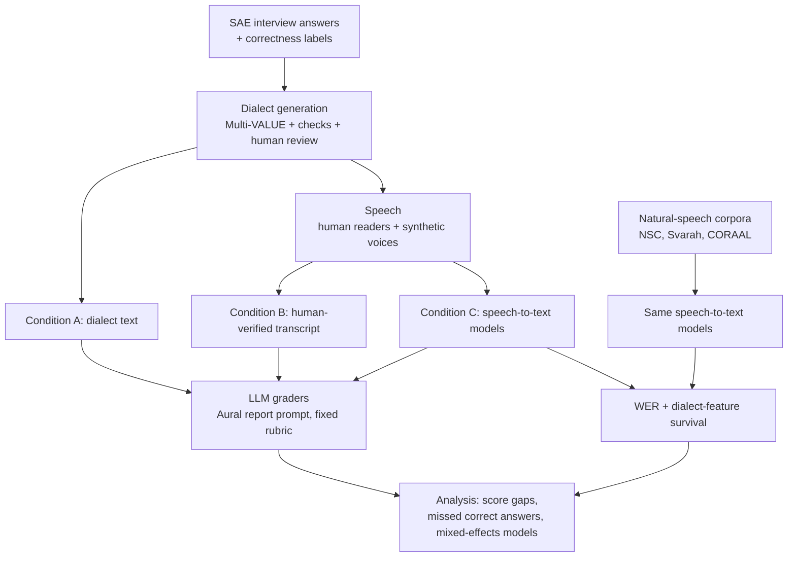

# Dialect generation pipeline

Turns SAE interview answers into dialect versions (via Multi-VALUE), flags risky ones, and leaves room for manual review.

## Planned study architecture (tentative)

> **Tentative, until the team decides otherwise.** Only the dialect generator (step 2 below) exists today. Everything else is planned. The full plan, open decisions and work list are in [PLAN.md](PLAN.md).

The study asks whether an AI interview pipeline (speech-to-text plus an LLM grader) scores dialect answers lower than equally correct Standard American English answers, and which step causes any gap.

1. **Answer bank:** SAE answers to technical interview questions, each with a correctness label.
2. **Dialect generation** (`generate_dialects.py`, this repo): Indian English, Singlish, and possibly AAE, then reviewed by speakers of each variety.
3. **Speech:** people read the variants aloud. Synthetic voices are a possible scale-up.
4. **Speech-to-text:** several open models (for example Whisper large-v3 and current Open ASR Leaderboard leaders), run offline on a GPU cluster.
5. **Grading:** the report prompt from the open-source [Aural](https://github.com/1146345502/aural-oss) interview platform, run against open LLMs served by vLLM plus one hosted model. Prompt, rubric and model versions are frozen before any data runs.
6. **Analysis:** score gaps within each correctness level, how often correct answers are failed, how many dialect features survive speech-to-text, and mixed-effects models.

The three grading conditions keep the effects apart:
- **A vs B:** speakers standardizing the grammar while reading.
- **B vs C:** speech-to-text errors and standardizing.
- **Condition A alone:** pure grader bias.

## Setup (Python >=3.11)

    pip install -r requirements.txt
    python -m spacy download en_core_web_sm
    python -c "import nltk; [nltk.download(p) for p in ('wordnet','omw-1.4','cmudict')]"

## Steps

1. Put your SAE answers in a CSV with columns `response_id`, `question_id`, `correctness`, `text` (optional: `protected_terms`, `|`-separated, kept verbatim).
2. Generate variants:

       python generate_dialects.py data/sample_responses.csv data/dialect_variants.csv --dialects SAE IndianEnglish

   Other dialects: `SingaporeanEnglish`, `AAE`.
3. Open the output CSV and review every row marked `needs_review`. Fill in `reviewer`, `meaning_preserved`, `natural`, and `revised_text` if a fix is needed.
4. Speakers read the `final_text` column (your revision if present, otherwise the automatic variant).

Re-running with `--force` regenerates variants but keeps your review columns for rows whose text didn't change.

## What it checks

Each dialect variant is compared to the original answer. A variant is flagged for review if it:

- **Changes protected terms:** code, `O(...)` expressions, or `protected_terms` must appear unchanged.
- **Changes numbers:** every number in the original must still be there.
- **Changes negation:** the count of "not", "no", "never", "n't", etc. must stay the same.
- **Loses logic words:** words like "if", "because", "but", "so", "or" can't disappear.
- **Drops too many content words:** at least 80% of the original's main words must survive.
- **Gets much longer or shorter:** length must stay within 60-140% of the original.
- **Doesn't change at all:** the variant must differ from the original.

It tries up to 10 random variants and keeps the first one that passes. If none pass, it keeps the closest and flags it. These checks can't catch awkward or ungrammatical wording, so a human still needs to review the output.

