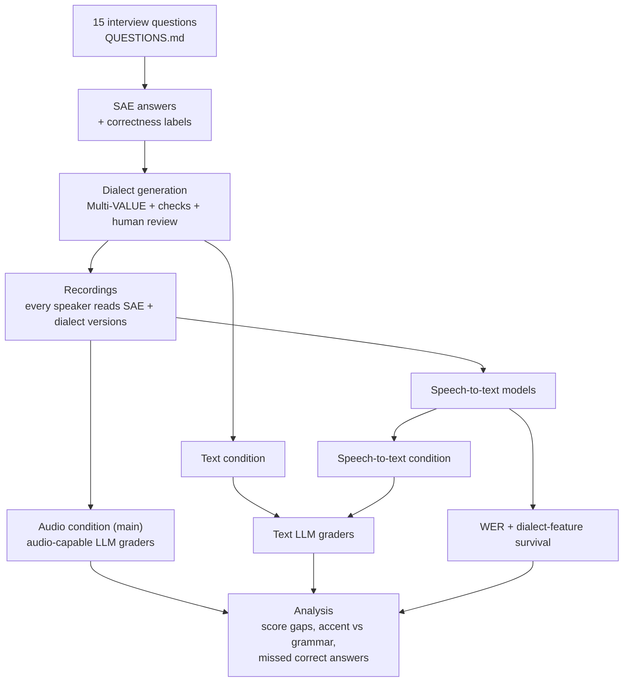

# Dialect generation pipeline

Turns SAE interview answers into dialect versions (via Multi-VALUE), flags risky ones, and leaves room for manual review.

## Planned study architecture (tentative)

> **Tentative, until the team decides otherwise.** Only the dialect generator (step 2 below) exists today. Everything else is planned. The full plan, open decisions and work list are in [PLAN.md](PLAN.md).

The study asks whether AI interview grading scores people differently depending on the English dialect they speak, when their answers are equally correct. It separates three possible sources of a gap: how people sound (accent, delivery), dialect grammar, and the speech-to-text step used by text-based tools.

1. **Questions:** 15 technical interview questions ([QUESTIONS.md](QUESTIONS.md)).
2. **Answer bank:** SAE answers at three correctness levels (correct / partial / incorrect), each label checked by a person.
3. **Dialect generation** (`generate_dialects.py`, this repo): Indian English, Singlish, and possibly AAE, then reviewed by speakers of each variety.
4. **Recordings:** every speaker reads both SAE and dialect versions, all with the same recording setup.
5. **Grading.**
   - **Audio (main):** recordings go straight to audio-capable LLMs. Candidates are hosted models (Gemini, OpenAI gpt-audio) and open models on a GPU cluster (Qwen3-Omni, Voxtral, MERaLiON).
   - **Text and speech-to-text:** text LLM graders score the reviewed text and the speech-to-text transcripts.
   - Prompts and model versions are frozen before any data runs.
6. **Analysis:** score gaps within each correctness level, accent vs grammar effects, how often correct answers are failed, and how much dialect survives speech-to-text.

How the conditions keep the effects apart:
- **Audio vs text:** what the voice adds beyond the words.
- **Speech-to-text vs text:** how much transcription changes the score.

## Setup (Python >=3.11)

    pip install -r requirements.txt
    python -m spacy download en_core_web_sm
    python -c "import nltk; [nltk.download(p) for p in ('wordnet','omw-1.4','cmudict')]"

## Steps

1. Put your SAE answers in a CSV with columns `response_id`, `question_id`, `correctness`, `text` (optional: `protected_terms`, `|`-separated, kept verbatim).
2. Generate variants:

       python generate_dialects.py data/sample_responses.csv data/dialect_variants.csv --dialects SAE IndianEnglish

   Other dialects: `SingaporeanEnglish`, `AAE`.
3. Open the output CSV and review every row marked `needs_review`. Fill in `reviewer`, `meaning_preserved`, `natural`, and `revised_text` if a fix is needed.
4. Speakers read the `final_text` column (your revision if present, otherwise the automatic variant).

Re-running with `--force` regenerates variants but keeps your review columns for rows whose text didn't change.

## What it checks

Each dialect variant is compared to the original answer. A variant is flagged for review if it:

- **Changes protected terms:** code, `O(...)` expressions, or `protected_terms` must appear unchanged.
- **Changes numbers:** every number in the original must still be there.
- **Changes negation:** the count of "not", "no", "never", "n't", etc. must stay the same.
- **Loses logic words:** words like "if", "because", "but", "so", "or" can't disappear.
- **Drops too many content words:** at least 80% of the original's main words must survive.
- **Gets much longer or shorter:** length must stay within 60-140% of the original.
- **Doesn't change at all:** the variant must differ from the original.

It tries up to 10 random variants and keeps the first one that passes. If none pass, it keeps the closest and flags it. These checks can't catch awkward or ungrammatical wording, so a human still needs to review the output.

